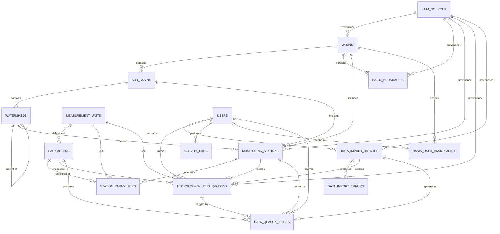

# EEC-BHDMS — Phase 3: Database Architecture, Migrations & Seeders

**Status:** Complete and verified on MariaDB 10.4.32
**Scope:** Geographic hierarchy, master data, time-series observations, imports, quality control, audit
**Out of scope:** GIS interface, Excel transformation UI, hydrological screens

---

## 1. Entity relationship diagram



The diagram is Mermaid source: paste it into any Mermaid renderer, or view this file in VS Code/GitHub.

---

## 2. Relationships explained

### Geographic hierarchy (strict containment)

| Relationship | Cardinality | Rule |
|---|---|---|
| `basins` → `sub_basins` | 1 : 0..n | Every sub-basin belongs to exactly one basin. Deleting a basin that still has sub-basins is **blocked** (`restrict`). |
| `sub_basins` → `watersheds` | 1 : 0..n | Watersheds are anchored to a sub-basin. |
| `watersheds` → `watersheds` | 0..1 : 0..n | `parent_id` gives a configurable catchment tree of arbitrary depth; `level` records the depth, `sub_basin_id` keeps the whole tree inside one sub-basin. |
| `basins` → `basin_boundaries` | 1 : 0..n | Multiple polygons per basin (different sources, versions, vintages). `is_primary` marks the one used for display. |
| `basins` → `monitoring_stations` | 1 : 0..n | Mandatory basin attribution; sub-basin and watershed are optional refinements. |

`basins.boundary` holds an optional **simplified display geometry**. Authoritative polygons live in `basin_boundaries.geom`, which is `NOT NULL` and spatially indexed.

### Master data

| Relationship | Cardinality | Rule |
|---|---|---|
| `measurement_units` → `parameters` | 1 : 0..n | Each parameter has a default unit (mm, °C, m³/s…). |
| `monitoring_stations` ↔ `parameters` | n : n via `station_parameters` | Defines which parameters a station is equipped for, with its own unit, sensor reference and depth. Unique on (station, parameter). |
| `data_sources` → everything | 1 : 0..n | Provenance for geography, stations, observations and imports. |

### Time series

| Relationship | Cardinality | Rule |
|---|---|---|
| `monitoring_stations` → `hydrological_observations` | 1 : 0..n | Deleting a station with data is **blocked** (`restrict`) — records are never silently lost. |
| `parameters` → `hydrological_observations` | 1 : 0..n | Same restriction. |
| `data_import_batches` → `hydrological_observations` | 1 : 0..n | Optional back-reference for traceability; null if entered manually. |
| `hydrological_observations` → `data_quality_issues` | 1 : 0..n | Issues cascade when the observation is removed. |

### Audit and scoping

| Relationship | Cardinality | Rule |
|---|---|---|
| `users` → `activity_logs` | 1 : 0..n | `user_id` is nullable and nulls on delete so the log survives staff turnover. |
| `activity_logs.subject` | morph | Polymorphic link to any audited model. |
| `users` ↔ `basins` | n : n via `basin_user_assignments` | `access_level` (`view`/`manage`) is the hook for basin-scoped permissions; Phase 2 still enforces global roles. |

---

## 3. Duplicate protection for observations

A reading is identified by four columns:

```
(monitoring_station_id, parameter_id, measured_at, series_no)
```

`series_no` exists because a station can legitimately produce **more than one value for the same parameter and timestamp**:

- replicate gaugings by different operators,
- co-located sensors (e.g. two intakes),
- a check reading against the primary gauge.

The primary reading uses `series_no = 1`. A second legitimate value **must** be stored as `series_no = 2`, so an accidental re-import collides with the unique index instead of doubling the series. `record_type` (`observed`/`derived`/`estimated`) is a quality attribute, deliberately **not** part of the key — otherwise the same reading could be duplicated under a different label.

Indexes on the observation table: unique reading key, `(station, parameter, measured_at)` for series retrieval, `(parameter, measured_at)` for cross-station analysis, plus `measured_at` and `quality_status`.

---

## 4. Spatial storage and CRS

The installed server is **MariaDB 10.4.32**, not MySQL 8, and this changes what is possible:

| Capability | Result on this server |
|---|---|
| `SPATIAL INDEX` on InnoDB `GEOMETRY NOT NULL` | Supported |
| `SPATIAL INDEX` on a nullable geometry column | **Rejected** — `All parts of a SPATIAL index must be NOT NULL` |
| `GEOMETRY … SRID 4326` column attribute (MySQL 8 syntax) | **Rejected** — syntax error; MariaDB has no SRID column attribute |
| `ST_GeomFromText(wkt, 4326)`, `ST_SRID()`, `ST_Contains()`, `ST_Distance_Sphere()` | Supported |

Consequences, applied consistently:

- **CRS is WGS84 / EPSG:4326 everywhere.** Writes go through `ST_GeomFromText(?, 4326)` and every `basin_boundaries` row records `srid = 4326`.
- **`basin_boundaries.geom` is NOT NULL with a SPATIAL INDEX** — the authoritative polygon store, and the only column that can be spatially indexed without inventing coordinates.
- **`basins.boundary`, `sub_basins.boundary`, `watersheds.boundary` and `monitoring_stations.location` are nullable and unindexed.** A basin or station must be registrable before its survey geometry exists. `monitoring_stations` gets a `(latitude, longitude)` composite index; a spatial index can be added in a later migration once coordinates become mandatory.
- **Geometry writes use `BasinBoundary::createWithGeometry($attributes, $wkt)`** because a NOT NULL column cannot be inserted empty and patched afterwards. The same pattern will be used by the Phase 6 GeoJSON importer.

---

## 5. Table overview

| Table | Purpose | Notes |
|---|---|---|
| `data_sources` | Provenance register | `code` unique, type enum |
| `measurement_units` | Unit catalogue | 7 seeded units, decimals per unit |
| `basins` | Top-level registry | `code` unique, `data_status`, soft deletes |
| `sub_basins` | Basin children | `basin_id` restrict |
| `watersheds` | Configurable catchment tree | `parent_id` self-FK, `level` |
| `basin_boundaries` | Versioned authoritative polygons | `geom` NOT NULL + SPATIAL INDEX, `is_primary` |
| `monitoring_stations` | Station network | basin required; sub-basin/watershed optional; lat/lng + POINT nullable |
| `parameters` | Measurement catalogue | DB-driven, never hardcoded |
| `station_parameters` | Station capability | unique (station, parameter) |
| `data_import_batches` | Upload sessions | uuid, checksum, counters |
| `hydrological_observations` | Time series | unique reading key, SRID-free values |
| `data_import_errors` | Row-level failures | cascade with batch |
| `data_quality_issues` | QC findings | observation/batch/station/parameter links, resolution trail |
| `activity_logs` | Audit trail | morph subject, `created_at` only |
| `basin_user_assignments` | Basin-scoped access | unique (basin, user) |

Every table uses InnoDB, `utf8mb4_unicode_ci`, surrogate `id` primary keys, explicit foreign keys with deliberate `restrict` / `cascade` / `nullOnDelete` behaviour, and timestamps. Soft deletes are applied to geographic entities and boundaries only — observations and audit rows are never soft-deleted.

---

## 6. Seeders

| Seeder | Content | Idempotency |
|---|---|---|
| `RolePermissionSeeder` | 7 roles, 34 permissions from `config/access.php` | name-matched sync |
| `MeasurementUnitSeeder` | 7 units (mm, m, °C, %, m/s, h, m³/s) | `updateOrCreate` |
| `ParameterSeeder` | 7 parameters (rainfall, temperature, relative humidity, wind speed, sunshine duration, streamflow, water level) | `updateOrCreate` |
| `BasinSeeder` | 12 major basins | `firstOrCreate` so later verified geography is not overwritten |
| `UserSeeder` | one demo account per role (local only) | `updateOrCreate` + `syncRoles` |
| `DatabaseSeeder` | Runs the above in dependency order | — |

### The twelve basins

`BH-01 Abbay (Blue Nile)`, `BH-02 Awash`, `BH-03 Baro-Akobo (Sobat)`, `BH-04 Tekeze (Setit)`, `BH-05 Omo-Gibe`, `BH-06 Genale-Dawa`, `BH-07 Wabi Shebelle`, `BH-08 Rift Valley Lakes`, `BH-09 Afar-Danakil`, `BH-10 Aysha`, `BH-11 Ogaden`, `BH-12 Mereb (Mareb)`.

**No geography is fabricated.** Every row is seeded with:

- `area_km2`, `centroid_lat`, `centroid_lng`, `boundary` → **null**
- `data_status` → **pending**
- `source_note` → states that area, centroid, boundary and the official basin code await the verified EEC GIS dataset

`BH-xx` codes are **internal registry identifiers, explicitly not official government codes**. This satisfies the "unique basin code" requirement without claiming an authority that has not been provided. When the official dataset arrives, the rows are enriched rather than recreated (hence `firstOrCreate`).

---

## 7. Commands

```powershell
# apply the schema
php artisan migrate

# seed reference data (roles, units, parameters, basins + local demo users)
php artisan db:seed

# targeted seeding
php artisan db:seed --class=BasinSeeder
php artisan db:seed --class=MeasurementUnitSeeder

# full rebuild
php artisan migrate:fresh --seed
```

Expected output ends with:

```
Measurement units seeded: 7.
Parameters seeded: 7.
Basins seeded: 12 (geographic attributes marked pending).
Demo accounts ready for: Super Admin, System Administrator, …
```

The test database is `hydro_test` (set in `phpunit.xml`) so MySQL spatial behaviour is exercised instead of SQLite. Create it once per machine:

```powershell
php -r "`$pdo = new PDO('mysql:host=127.0.0.1', 'root', ''); `$pdo->exec('CREATE DATABASE IF NOT EXISTS hydro_test');"
```

---

## 8. Verification performed

| Check | Result |
|---|---|
| All 15 migrations on MariaDB 10.4.32 | Passed |
| SPATIAL index present on `basin_boundaries.geom` | `basin_boundaries_geom_spatialindex type=SPATIAL` |
| WGS84 round-trip (`ST_SRID = 4326`, `ST_Contains` hit) | Passed |
| Duplicate observation rejected; `series_no = 2` accepted | Passed |
| FK restrict (basin with sub-basins, station with observations) | Enforced |
| Unique basin code | Enforced |
| Seeder counts (12 basins / 7 parameters / 7 units / 7 roles / 34 permissions / 7 users) | Passed |
| Seeder idempotency (re-run) | 12 basins, no duplicates |
| Rollback of all 15 migrations, then re-migrate | Passed, 0 pending |
| Eloquent relationships (basin→sub-basins, station→observations, pivot, morph, soft delete) | Passed |
| Full test suite | **68 passed (284 assertions)** |

`tests/Feature/DatabaseSchemaTest.php` contains 11 tests / 47 assertions covering the table set, seeder policy, uniqueness, FK restriction, spatial round-trip, duplicate strategy, relationships, pivot, soft deletes and the audit trail.

---

## 9. Notes and decisions

| Item | Decision |
|---|---|
| MySQL 8 vs MariaDB 10.4 | Spatial syntax adapted to the installed engine; documented above. Confirm the production server edition before Phase 6. |
| `basins.boundary` vs `basin_boundaries` | Simplified display geometry vs authoritative versioned polygons. Avoids duplicating provenance and keeps the spatial index valid. |
| Station spatial index | Deferred until coordinates are mandatory; composite lat/lng index today. |
| Registration | Still disabled (Phase 2). |
| `activity_logs` | Custom table rather than `spatie/activitylog`, to keep the schema explicit and avoid another dependency. |
| `basin_user_assignments` | Schema and model exist; enforcement is intentionally deferred (global roles remain authoritative). |
| Seeder renames | `AccessControlSeeder` → `RolePermissionSeeder`, `DemoUserSeeder` → `UserSeeder`, matching the Phase 3 naming. Tests updated. |
| Tests database | Moved from SQLite `:memory:` to MySQL `hydro_test`; SQLite cannot model spatial types or MySQL enum/DDL faithfully. |

---

## 10. Phase gate

- [x] ERD prepared and relationships explained
- [x] Geographic tables with parent-child hierarchy
- [x] Boundary storage with SRID 4326 and spatial index
- [x] Master data driven by tables, not application code
- [x] Observation table with explicit duplicate strategy
- [x] Import, quality-control and audit tables
- [x] FKs, indexes, unique constraints, nullable fields, soft deletes
- [x] Six seeders, 12 verified basin names, no invented geography
- [x] FK, duplicate, spatial, seeder, rollback and relationship tests passing

**Ready for Phase 4 — Dashboard and application layout**, then the basin screens in Phase 5.
